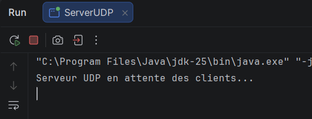
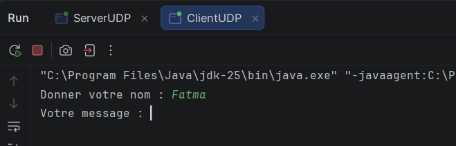
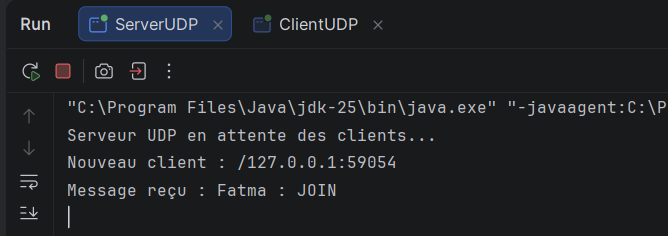
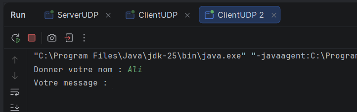
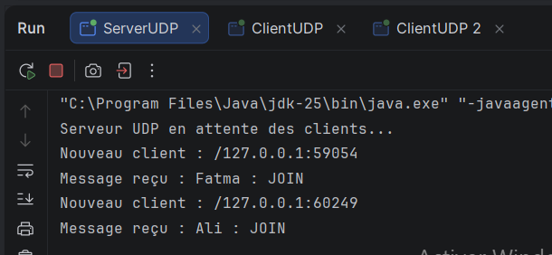
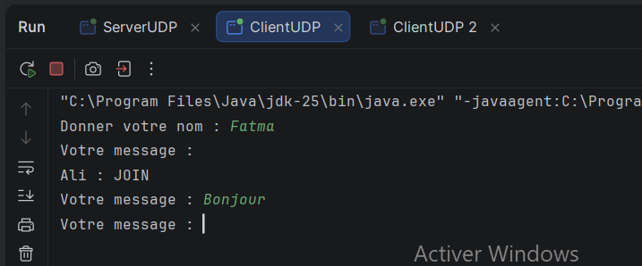
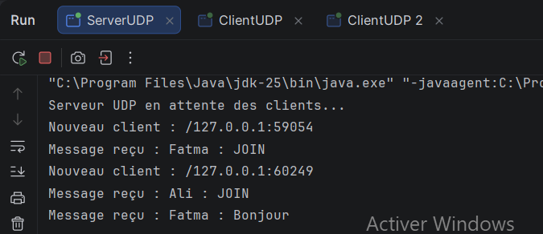
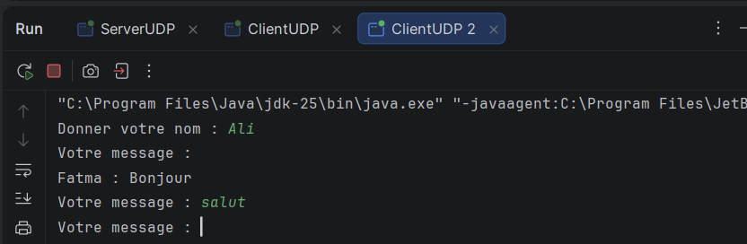
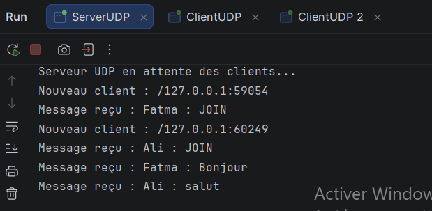
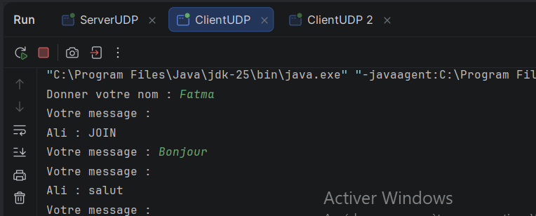

# TP 4 : Sockets en mode non-connecté UDP
## Service de chat Client/Serveur avec UDP

**Matière :** Développement d'applications réparties
**Auditoire :** LSI 3 – Faculté des Sciences de Sfax
**Année universitaire :** 2026 – 2027
**Réalisé par :** *Fatma Mhadhbi*

---

## 1. Objectif

Mettre en place une application de chat client/serveur en Java basée sur le protocole **UDP** (`DatagramSocket` et `DatagramPacket`), permettant à plusieurs clients d'échanger des messages de manière asynchrone (quasi temps réel) via un serveur central.

## 2. Environnement

- JDK ≥ 1.8
- IDE : *Eclipse / IntelliJ IDEA / VS Code* (à préciser)
- Git / GitHub

## 3. Structure du projet

```
votreNomPrenom_LSI3_DevAppReparties/
├── src/
│   ├── serverPackage/
│   │   └── ServerUDP.java
│   └── clientPackage/
│       └── ClientUDP.java
├── screenshots/
└── README.md
```

---

## 4. Étape 2 : Chat unidirectionnel (un seul client)

### Principe
- Le **serveur** écoute sur le port **1234** (liaison via `InetSocketAddress`) et affiche, pour chaque datagramme reçu, l'adresse (IP:port) de l'expéditeur et le contenu du message.
- Le **client** demande un nom d'utilisateur, lit les messages saisis au clavier et les envoie au serveur sous la forme `NomUtilisateur : message`.

### Exécution

**1. Démarrage du serveur** : il se lie au port 1234 et attend les clients.



**2. Démarrage du client** : saisie du nom d'utilisateur (*Fatma*).



**3. Réception côté serveur** : le serveur affiche l'adresse (IP:port) de l'expéditeur et le message reçu.



### Synthèse
Le client envoie ses messages dans des datagrammes UDP et le serveur les reçoit et les affiche avec l'adresse de l'expéditeur (`/127.0.0.1:59054`). La communication est en mode **non-connecté** : aucun établissement de connexion préalable n'est nécessaire, chaque datagramme est indépendant.

---

## 5. Étape 3 : Chat bidirectionnel et diffusion à plusieurs clients

### Côté serveur (`ServerUDP`)
1. Création du `DatagramSocket` lié à `0.0.0.0:1234`.
2. Maintien d'une liste `List<SocketAddress>` des clients connus.
3. À chaque datagramme reçu :
   - l'adresse de l'expéditeur est ajoutée à la liste si elle n'y est pas déjà (simulation de la « connexion ») ;
   - le message est affiché ;
   - le message est retransmis à **tous les clients enregistrés sauf l'expéditeur**.

### Côté client (`ClientUDP`)
1. Saisie du nom puis envoi d'un message d'inscription (`nom : JOIN`) pour que le serveur enregistre l'adresse du client.
2. Un **thread de réception** tourne en parallèle et affiche en continu les messages diffusés par le serveur (`client.receive()` est bloquant).
3. Le **thread principal** lit les messages au clavier et les envoie au serveur.
4. La saisie de `exit` ferme la socket et quitte le chat.

L'utilisation de deux threads permet l'envoi et la réception **simultanés**, sans que la lecture clavier bloque l'affichage des messages entrants.

### Test du service de chat

**1. Deuxième client** : lancement d'une seconde instance (*Ali*).



**2. Serveur** : les deux clients sont enregistrés (ports différents : 59054 et 60249).



**3. Fatma envoie « Bonjour »** (elle a aussi reçu le message d'inscription d'Ali).



**4. Le serveur reçoit le message de Fatma :**



**5. Ali reçoit « Fatma : Bonjour » en temps réel**, puis répond « salut » :



**6. Le serveur reçoit le message d'Ali :**



**7. Fatma reçoit « Ali : salut » :**



### Synthèse
Les messages envoyés par un client sont reçus par le serveur puis diffusés à tous les autres clients enregistrés, en temps quasi réel. L'expéditeur ne reçoit pas son propre message : Fatma n'a pas reçu « Fatma : Bonjour » mais a reçu « Ali : salut ». Le serveur identifie chaque client par son `SocketAddress` (IP + port), ce qui remplace la notion de connexion absente en UDP. Le thread de réception côté client permet l'affichage des messages entrants pendant que l'utilisateur saisit les siens.

---

## 6. Limites et remarques

- UDP ne garantit ni la livraison, ni l'ordre, ni l'absence de doublons des datagrammes : des messages peuvent être perdus ou arriver dans le désordre (surtout sur un réseau non local).
- Le serveur n'est pas informé du départ d'un client (`exit`) : l'adresse reste dans la liste. Une amélioration possible serait d'envoyer un message `LEAVE` et de retirer le client de la liste.
- La taille des messages est limitée par le buffer (1024 octets).
- Le serveur est monothread et traite les datagrammes séquentiellement, ce qui suffit pour ce TP.

## 7. Conclusion

Ce TP a permis de maîtriser l'échange de datagrammes avec `DatagramSocket` et `DatagramPacket`, la gestion de plusieurs clients côté serveur et l'utilisation des threads côté client pour un chat asynchrone en mode non-connecté.

## 8. Lancement

```bash
# Compiler
javac -d bin src/serverPackage/ServerUDP.java src/clientPackage/ClientUDP.java

# Lancer le serveur
java -cp bin serverPackage.ServerUDP

# Lancer chaque client dans un terminal séparé
java -cp bin clientPackage.ClientUDP
```
